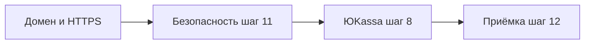

# ТЗ — фаза B: домен, безопасность, оплата

**Статус фазы A (продукт):** **завершена** (2026-11-27).  
**Статус фазы B:** **в работе** — инфраструктура и монетизация до публичного запуска по домену.

Источник статуса по задачам: **`PROGRESS.md`** (галочки).  
Поведение отчётов и антибот: **`docs/report-policy.md`**, **`.cursor/rules/report-antibot-policy.mdc`**.

---

## Что входит в «продукт готов» (фаза A — сделано)

| Область | Результат |
|---------|-----------|
| Скан | До **30** приоритетных страниц, бюджет **10 мин**, Playwright, Nuclei, passive probes, stale/restart |
| Комплаенс | 152/168‑ФЗ, SEO, антибот/`access`, честный scope, справочник КоАП |
| UI | Главная, `/check/{id}`, таймер 10:00, findings без paywall, мобильная вёрстка |
| Отчёты | HTML short (**490 ₽**) / extended (**990 ₽**), оформление по разделам, скачивание без гейта оплаты |
| Прод | `http://194.87.220.206:8080`, nginx **:8080**, cron регрессии |
| Не в проде | ЮKassa, превью vs полный отчёт, GigaChat, подписка, очередь масштаба |

---

## Очередность фазы B (рекомендуемая)

Параллельно после домена: обновить SEO (`docs/seo-setup.md`).  
**Не начинать** массовую рекламу и `docs/mass-scale-tz.md` до стабильного HTTPS и лимитов API.

---

## B1. Домен и публичный URL

**Цель:** пользователь заходит по **HTTPS** на боевой домен; API и фронт с одного origin (через nginx).

### Предусловия (VPS)

- Порт **:80** на хосте занят **ai-aggregator** — для site-audit сейчас **:8080** (см. `docs/prod-snapshot.md`).
- Варианты:
  1. **Поддомен** + **nginx :443** (отдельный `server_name`, сертификат Let's Encrypt) → прокси на `127.0.0.1:3001` / `8001`.
  2. Или вынести site-audit на отдельный IP/VPS с `:443` без конфликта с ai-aggregator.

### Чеклист

- [ ] Зарегистрировать домен, DNS **A** (или **CNAME**) на IP VPS.
- [ ] `deploy/nginx-site-audit.conf` (или Caddy): TLS, редирект HTTP→HTTPS для **этого** `server_name`.
- [ ] На сервере обновить **только** `.env` (не в git):
  - `PUBLIC_SITE_URL=https://<домен>`
  - `NEXT_PUBLIC_API_URL=https://<домен>` (тот же origin)
  - `CORS_ORIGINS=https://<домен>`
  - `PAYMENT_RETURN_URL=https://<домен>/check/{id}` или согласованный return path
- [ ] `docker compose ... up -d --build` (frontend пересобрать из‑за `NEXT_PUBLIC_*`).
- [ ] Проверки: `/`, `/api/health`, `/robots.txt`, `/sitemap.xml` (см. `docs/seo-setup.md`).
- [ ] Вебмастер / Search Console, sitemap на новый URL.

**Артефакты:** обновлённый `docs/prod-snapshot.md`, дата в `PROGRESS.md`.

---

## B2. Безопасность и ограничения (шаг 11 ТЗ)

**Цель:** снизить злоупотребления публичным API и риски утечки данных на хосте.

### Приложение (backend)

- [ ] **Rate limit** на `POST /api/scans` (по IP / fingerprint): N запросов в час, понятный 429.
- [ ] Валидация `target_url`: схема https/http, запрет private IP, metadata, file://, loopback.
- [ ] Лимит длины URL и таймаутов уже есть — сверить с прод-нагрузкой.
- [ ] Закрыть или ограничить по IP **Mailpit :8081** в проде (только VPN/SSH tunnel).
- [ ] Сверить, что **Swagger `/docs`** на проде отключен или за basic auth (по решению).
- [ ] Логи без секретов; ротация логов Docker.

### Прокси и хост

- [ ] Заголовки: `Strict-Transport-Security`, `X-Content-Type-Options`, `X-Frame-Options` / CSP базовая.
- [ ] `ufw`: открыты 22, 80/443 (или только нужные), закрыть лишнее.
- [ ] SSH: ключи, по возможности отключить password login.
- [ ] Резервные копии Postgres (расписание, тест восстановления).

### После ЮKassa

- [ ] Проверка подписи webhook; идемпотентность обработки `payment.succeeded`.
- [ ] Секреты `YOOKASSA_*` только в `.env` на сервере.

**Связанные документы:** `docs/server-setup.md`, `docs/deployment.md`.

---

## B3. ЮKassa и гейт отчётов (шаг 8 ТЗ)

**Цель:** полные HTML-отчёты и скачивание — **только после оплаты**; на экране — превью по `docs/report-policy.md`.

### Тарифы (актуальные в коде)

| Код | Цена | Содержание |
|-----|------|------------|
| `short` | **490 ₽** | Сводка КоАП + разделы без «что сделать» |
| `extended` | **990 ₽** | + резюме + рекомендации |

Шаблоны: `backend/app/reports/compose.py`, `html_render.py`, `docs/paid-report-format.md`.

### Чеклист реализации

- [ ] Регистрация магазина ЮKassa, тестовый и боевой shop id / secret.
- [ ] Env: `YOOKASSA_SHOP_ID`, `YOOKASSA_SECRET_KEY`, `YOOKASSA_WEBHOOK_SECRET` (см. `.env.example`).
- [ ] API:
  - [ ] `POST /api/payments/create` — привязка к `scan_id`, `variant` short|extended, сумма, return URL.
  - [ ] Webhook `POST /api/payments/yookassa/webhook` — статус в таблице `payments`.
  - [ ] `GET /api/scans/{id}/paid-report/download` — **403** без `succeeded` payment для данного variant (или token).
- [ ] UI (`ScanResults.tsx`): кнопки «Оплатить и скачать» вместо прямого download; превью findings (фаза B: урезать или оставить все — **зафиксировать с заказчиком** перед релизом гейта).
- [ ] Чек / оферта: ссылка на дисклеймер, e-mail поддержки.
- [ ] Тестовый платёж end-to-end на staging или test mode.

### БД

Схема `payments`, `subscriptions` уже есть (`docs/database.md`) — нужны **роуты и сервис**, не новая миграция (если полей хватает).

---

## B4. Финальная приёмка (шаг 12 ТЗ)

- [ ] Регрессия strict + выборочно panel на **боевом домене**.
- [ ] Ручная проверка: главная, скан, антибот-сайт, скачивание отчёта после оплаты.
- [ ] Юрист (опционально): формулировки КоАП в отчётах.
- [ ] Обновить `docs/prod-snapshot.md` — commit, домен, включена ли оплата.

---

## Отложено (не блокирует B1–B4)

| Тема | Документ |
|------|----------|
| GigaChat, уровни отчётов LLM | шаги 6–7, `PROGRESS.md` |
| Подписка | шаг 8.5 |
| Серверный PDF (WeasyPrint) | `docs/paid-report-format.md` |
| Масштаб ≥20 параллельных сканов | `docs/mass-scale-tz.md` |
| Outreach-машина | `docs/outreach-machine-tz.md` (после B + стабильный прод) |
| ZAP отдельным контейнером | шаг 3 |

---

## Следующий практический шаг

1. **Выбрать домен** и схему TLS (nginx :443 vs отдельный IP).
2. Внести DNS и обновить `.env` + деплой.
3. В той же итерации — **rate limit + SSRF** на `POST /api/scans`.
4. Подключить **ЮKassa test** и гейт download.

После каждого завершённого пункта — галочка в **`PROGRESS.md`** и при смене инфры — **`docs/prod-snapshot.md`**.

*Версия: 2026-11-27.*